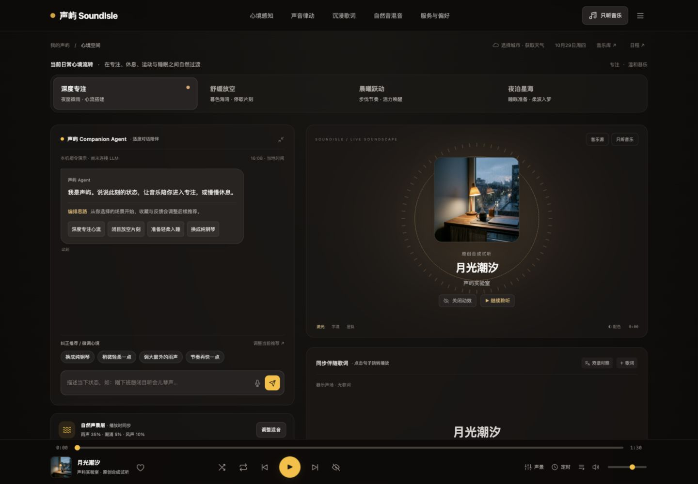

> 历史版本 v0.3。音乐来源、浏览器直连方式和目录已被 v0.4 替代；当前实现见 [产品文档](../声屿-产品完整文档.md)。

# 声屿 · 音乐伴侣——产品完整文档

> 文档版本：v0.3（SoundIsle UI 改版与当前实现快照）
> 更新日期：2026 年 10 月 29 日
> 产品形态：第一阶段 Web；第二阶段 PC 与 Android
> 当前阶段：可体验的个人网页版原型，尚未达到正式上线验收状态
> 本文用途：统一产品、设计、研发、测试与后续交付的范围和判断标准

---

## 阅读说明

本文同时描述产品目标、当前实现和后续规划。为避免把设计方案当作已交付能力，使用以下状态：

- **已实现并局部验证**：已有代码，并完成对应的本机交互或逻辑验证；不代表所有设备和异常场景均已覆盖。
- **已实现，待真实联调**：已完成界面或接口适配，但没有可用服务、真实账号或相应设备的验证证据。
- **规划中**：产品需要该能力，当前尚未实现。
- **待决策**：需要结合部署条件、用户选择或验证结果确定方案。

优先级定义：

- **P0**：第一阶段形成可用闭环或正式提供给用户前必须完成。
- **P1**：核心闭环之后优先完善的体验与可靠性能力。
- **P2**：增强功能和中长期探索。

**当前最重要的事实：页面已发布，但在线音乐后端尚未部署，真实 LLM 也未完成联调；不能把接口适配完成理解为网易云曲库已经连通。**

---

## 目录

1. 产品概述与目标
2. 已确认需求与范围
3. 用户、场景与核心体验
4. 产品结构与页面设计
5. 功能需求
6. 推荐系统设计
7. Agent 与语音设计
8. 视觉、歌词与动效规范
9. 音乐源与外部服务
10. 数据设计与存储
11. 技术架构与部署
12. 隐私、安全与用户控制
13. 跨平台规划
14. 非功能要求
15. 验收与测试
16. 里程碑与研发顺序
17. 当前交付状态与已知限制
18. 待决策事项与风险
19. 指标、成本与后续建议
20. 附录：运行、交付与参考资料

---

## 1. 产品概述与目标

### 1.1 产品名称与定位

暂定名称：**声屿**。

一句话定位：**一个理解用户当下需求，用音乐与适度对话提供陪伴的应用。**

产品围绕“听音乐”组织体验。Agent 负责理解用户表达，将个人喜好、天气、时间、日程和对话氛围转化为音乐场景与可执行操作。

### 1.2 核心价值

1. 降低选择音乐的负担：用户可以描述需求，不必每次手动找歌。
2. 让音乐融入日常：在专注、休息、运动和睡眠准备之间自然过渡。
3. 提供舒适的沉浸体验：通过歌词、封面配色和音频律动增强听觉感受。
4. 保留用户控制：可以只听音乐、关闭动效、限制自动切歌，或纠正推荐。
5. 支持可替换服务：音乐源、聊天模型与语音服务不绑定为同一个供应商。

### 1.3 第一阶段成功条件

第一阶段应形成以下闭环：

> 用户表达需求或选择场景 → 获取可播放候选 → 推荐并播放 → 展示真实状态 → 用户反馈 → 后续推荐调整。

正式验收还需要满足：

- 网易云真实服务、真实账号及歌曲播放完成验证。
- 至少一个真实 LLM 可以完成对话和播放器操作。
- 推荐失败、音源不可播或模型不可用时，用户仍可手动使用播放器。
- 专注、睡眠定时与推荐纠正能够独立工作。
- 手机和桌面浏览器的主要操作可用。

### 1.4 第二阶段成功条件

在复用 Web 产品能力的基础上，补齐 PC 与 Android 的原生体验：安装、后台播放、系统媒体控制、设备日历和系统通知。

### 1.5 当前不纳入核心范围

- 音乐版权交易或内容分发平台。
- 音乐创作、专业音频制作和直播。
- 付费歌曲权限绕过。
- 医疗诊断或心理治疗服务。
- 初期的社交社区、动态广场和复杂商业会员体系。

---

## 2. 已确认需求与范围

### 2.1 用户已确认的方向

- 先开发网页版，再封装为 PC 和 Android 应用。
- 根据个人偏好、当地天气和日程推荐歌单。
- 提供完整、操作简单的音乐播放器。
- 界面具有科技感，播放时有光影与律动。
- 网易云音乐作为主要在线音乐来源。
- 天气使用适合原型的免费查询服务。
- 日程可以在应用内管理，后续读取本机设备日历。
- Agent 定位为心灵伴侣，支持文字和语音交流。
- 可配置不同 LLM，并能根据需求或聊天场景调整音乐。
- 增加睡眠定时、专注时段、推荐纠正三个功能。
- 视觉和音乐源接入参考 Folia。
- 当前没有现成的音乐 API 服务，需要后续部署音乐后端。

### 2.2 对 Folia 参考方向的具体理解

视觉参考：

- 歌词作为播放页的核心视觉内容。
- 大面积沉浸舞台和封面配色。
- 随音乐变化的流动背景。
- 多种歌词排版与动画模式。

音乐来源参考：

- 网易云 Enhanced API 服务。
- 可扩展的 QQ、酷狗、Navidrome 与本地音乐来源。
- 歌曲元数据、播放地址、歌词和账号能力采用统一接入层。

当前界面、背景与适配器为声屿的独立实现，没有并入 Folia 的完整源码、品牌素材或歌词渲染引擎。“参考 Folia”不等于复现其全部主题和能力。

### 2.3 第一阶段目标范围

**P0：**

- 稳定的播放器与音乐库。
- 网易云服务部署、登录与真实播放。
- 场景推荐和反馈修正。
- 沉浸歌词与可关闭的动效。
- 内置日程。
- 天气查询及无天气时的降级。
- 文字伴侣与至少一个真实模型。
- 基础语音输入与回复朗读。
- 专注和睡眠计时。
- 必要的隐私、错误提示和数据清除能力。

**P1：**

- 歌曲标签、推荐质量和播放稳定性提升。
- 多个模型配置档案、独立语音服务适配。
- 日程导入完善、提醒与计时恢复。
- QQ、酷狗、Navidrome 的真实服务验证。
- 长对话管理、可管理的偏好记忆。
- 数据导出、备份与可选同步。

**P2：**

- 更多歌词模式和主题编辑。
- 音乐混合、跨曲淡入淡出和更丰富的环境采样音。
- 更完整的跨设备体验和个性化策略。

---

## 3. 用户、场景与核心体验

### 3.1 首要用户

第一阶段优先服务个人使用者：日常听歌，希望通过自然语言快速获得适合当下状态的音乐，并愿意使用自有模型或音乐服务。

初期按单用户、本机优先的方式验证产品价值；不默认已经存在多用户账户与云端同步。

### 3.2 主要使用场景

#### 场景 A：工作与专注

用户说：“接下来 45 分钟要写东西，别放太吵的。”

目标行为：

1. 识别专注需求和持续时间。
2. 优先筛选低干扰音乐。
3. 按用户的切歌策略应用场景。
4. 开启 45 分钟计时。
5. 到点轻量提醒，避免持续打断。

#### 场景 B：疲惫与放松

用户说：“今天有点累。”

目标行为：

1. 简短回应，不武断判断心理状态。
2. 根据偏好建议舒缓场景。
3. 依据设置决定立即切换、曲终切换或仅建议。
4. 用户可以选择“只听音乐”。

#### 场景 C：睡前陪伴

用户说：“半小时后帮我停下来。”

目标行为：

1. 确认定时含义并显示停止时间。
2. 进入适合休息的场景。
3. 到点逐渐降低音量并停止。
4. 提示网页计时的后台与休眠限制。

当前本机规则演示主要识别数字分钟；“半小时”等自然表达需要真实模型或后续更完整的解析。

#### 场景 D：日程联动

用户创建“14:00—15:00 阅读”并选择专注场景。

目标行为：

- 进入该时段后调整推荐场景。
- 保留当前歌曲，或遵循用户选择的自动切歌方式。
- 推荐理由说明正在参考日程。

#### 场景 E：沉浸听歌

用户打开歌曲，进入沉浸模式。

目标行为：

- 封面、歌名、歌手、来源和歌词清楚可见。
- 背景随音乐能量与主题配色变化。
- 有逐词时间轴时提供逐词高亮。
- 没有歌词时展示真实的无歌词状态。

#### 场景 F：纠正推荐

用户认为推荐不合适，选择“以后少推荐”。

目标行为：

- 立即记录反馈。
- 自动推荐避开该歌曲。
- 音乐库仍允许手动播放。
- 可以重置反馈。

### 3.3 核心体验原则

- 用户明确表达优先于系统推断。
- 推荐理由要能被理解和纠正。
- 操作结果以播放器真实状态为准。
- 没有连接服务时明确说明。
- 用户不聊天，也能完整听歌。
- 动效服务于音乐与阅读，不妨碍操作。

---

## 4. 产品结构与页面设计

### 4.1 一级结构

1. **此刻**：当前歌曲、沉浸舞台、场景推荐、专注与睡眠入口。
2. **音乐库**：本地导入、收藏、搜索、来源切换、歌单导入。
3. **我的日程**：查看、新建、编辑、删除、日历文件导入。
4. **偏好与连接**：音乐偏好、切歌策略、动效、模型、音乐源和本机数据。
5. **伴侣面板**：左侧常驻对话、快捷表达与语音输入；可通过“只听音乐”隐藏。
6. **全局播放器**：贯穿页面的基本播放控制。
7. **自然声混音台**：五层本机合成声景、比例调整、全静音和场景预设。

当前界面以用户提供的 SoundIsle 项目为准：顶部导航、暖黑与琥珀色、左侧常驻对话、右侧封面律动与独立歌词卡片，底部固定播放控制。音乐库与日程保留入口，服务与偏好通过弹窗打开。

### 4.2 此刻页

主要内容：

- 当前歌曲封面、标题、歌手、来源。
- 歌词或器乐状态。
- 开始/暂停、沉浸模式切换。
- 流光、字境、星轨模式切换。
- 歌词导入与配色切换。
- 当前场景、推荐理由和候选歌曲。
- 专注与睡眠定时入口。

### 4.3 音乐库页

主要内容：

- 已加入音乐库的歌曲。
- 曲名、歌手及风格关键词搜索。
- 只看喜欢。
- 本地音频导入。
- 在线来源切换。
- 在线搜索结果的播放和加入操作。
- 连接与账号管理。
- 歌单 ID 或链接导入。

当前“加入音乐库”不等同于在网易云等平台收藏，也不等同于下载音频。

### 4.4 日程页

主要内容：

- 日程标题、起止时间、关联音乐场景。
- 新建、编辑和删除。
- `.ics` 文件导入。
- 导入范围与不支持格式的说明。

### 4.5 设置页

按用户任务分组：

- 音乐偏好与自动切歌。
- 动效与系统语音朗读。
- 模型服务配置与连接验证。
- 音乐来源与账号。
- 对话清理与本机数据清除。

### 4.6 沉浸模式

- 通过“只听音乐”隐藏对话与推荐辅助区，扩大律动与歌词区域，减少干扰。
- 保留关键播放控制和退出入口。
- 进入音乐库时应退出沉浸状态。
- 桌面支持 Escape 退出。
- 沉浸模式属于应用内布局，不等同于操作系统的全屏或后台播放。

### 4.7 首次使用流程

目标流程：

1. 直接试听，或导入自己的音频。
2. 可选设置音乐偏好。
3. 选择城市获取天气，允许跳过。
4. 按需添加日程。
5. 按需连接网易云和模型。
6. 使用过程中逐步补充偏好。

当前已提供分散入口，尚未实现专门的分步引导流程。

---

## 5. 功能需求

### F01 个人偏好与冷启动

**优先级：P0。状态：基础偏好已实现，完整画像规划中。**

目标能力：

- 记录喜欢的风格、歌手、语言及不希望出现的内容。
- 允许用户先使用，再逐步补充。
- 显式反馈比天气等弱信号有更高影响。
- 用户可以查看、修改、重置偏好。

当前实现：

- 风格选项：都愿意听听、氛围/轻音乐、钢琴/器乐、电子/节奏。
- 单曲喜欢、不喜欢和反馈重置。
- 尚未建立完整歌手、语言和长期收听画像。

### F02 播放器

**优先级：P0。状态：已实现并局部验证。**

基础控制：

- 播放、暂停、上一首、下一首。
- 进度拖动、音量控制。
- 队列查看、选择和移除。
- 顺序播放、随机播放、列表循环、单曲循环与队列结束停止。
- 收藏当前歌曲。
- 显示真实歌曲信息、进度和时长。
- 浏览器媒体会话控制入口。

错误要求：

- 音源为空、不可访问或权限不足时，提示原因并允许换歌。
- 浏览器阻止自动播放时，提供明确的手动播放入口。
- 播放未成功时，伴侣不能回复“已经播放成功”。

后续完善：

- 网络中断、播放地址过期后的恢复。
- 不可播歌曲的可靠跳过策略。
- 用户音质选择与可用性说明。
- 更完整的缓冲、重试和失败状态。
- 跨曲淡入淡出与音量均衡。

### F03 音乐库与歌单

**优先级：P0。状态：本机音乐库已实现；在线能力待联调。**

当前能力：

- 导入本地音频，保存到浏览器 IndexedDB。
- 在线搜索后将歌曲元数据加入本机音乐库。
- 按曲名、歌手或风格字符串搜索已加入的歌曲。
- 查看喜欢的歌曲。
- 网易云、QQ、Navidrome 歌单导入适配。

边界：

- 在线歌单导入属于一次性读取，不是持续同步。
- 网易云当前单次最多读取 1000 首。
- 酷狗歌单导入未实现。
- 尚未提供完整的应用内自建歌单编辑系统。
- 尚未实现对原音乐平台的收藏、歌单写入或播放历史回传。

### F04 歌词

**优先级：P0。状态：解析与粘贴同步已验证，在线读取待联调。**

目标与当前基础能力：

- LRC 逐行同步。
- YRC 逐词时间轴与高亮。
- 有翻译且时间可对齐时展示翻译。
- 点击歌词跳转到对应播放时间。
- 本地歌词文件导入或粘贴导入。
- 为当前歌曲保存本机覆盖歌词。
- 清除覆盖后恢复来源歌词。
- 无歌词时展示器乐/暂无歌词，不生成伪造歌词。

当前边界：

- 已覆盖基本 LRC/YRC 格式，尚未覆盖各平台全部扩展格式。
- TTML、QRC、KRC 原始格式完整解析不属于当前已交付范围。
- 没有逐词数据时不声称提供真实逐词同步。
- 歌词文件选择器未完成自动化实测，粘贴入口已验证。
- 文件导入入口限制约 500 KB；统一限制粘贴体积仍需完善。
- 时间偏移方向、复杂多时间标签及特殊字符需补充更多真实样本验证。

### F05 天气

**优先级：P0。状态：查询逻辑已实现，外部调用成功待验证。**

当前能力：

- 手动搜索和选择城市。
- 可选授权一次定位。
- 查询温度和天气类型。
- 本机缓存上次查询结果，显示缓存提示。
- 天气作为推荐辅助因素。

目标要求：

- 不定位也能使用应用。
- 查询失败不阻止播放器。
- 明确显示天气更新时间和是否使用缓存。
- 定期更新与缓存失效策略需要进一步完善。

当前选择为 Open-Meteo。现有资料注明免费托管接口用于非商业原型；正式运营前应重新核对服务套餐和条款。

### F06 日程

**优先级：P0。状态：内置增删改与保存已验证，导入待完整实测。**

当前字段：

- 日程标题。
- 开始时间与结束时间。
- 对应音乐场景。

当前行为：

- 标题不能为空。
- 结束时间必须晚于开始时间。
- 日程保存在当前浏览器。
- 当前时段存在日程时，尝试应用其音乐场景。
- 导入支持部分 UTC、浮动本地时间与全天单次事件。
- 重复规则、重复实例和命名时区 `TZID` 事件跳过并提示。

后续要求：

- 正确处理跨时区、夏令时、重复日程与全天事件。
- 明确重叠日程的选择规则。
- 支持“此日程不影响音乐”。
- 用户临时指定场景时，避免日程规则反复覆盖。
- 区分日程管理、日程提醒和音乐联动三个功能。

网页版不承诺直接读取各系统的本机日历；PC 和 Android 再通过原生能力接入。

### F07 文字伴侣

**优先级：P0。状态：本机指令演示已验证，真实模型待联调。**

交互要求：

- 输入文字，获得简短、自然的回复。
- 对话与音乐状态保持一致。
- 可以收起伴侣，只听音乐。
- 用户可以清空当前对话。
- 区分本机规则演示和真实模型连接。

当前可执行操作：

- 播放、暂停、下一首。
- 调整音量。
- 切换到四种既有场景。
- 设置专注与睡眠计时。
- 调整自然声景比例和器乐偏好。

尚未实现：

- 通过对话搜索任意歌曲并直接选歌。
- 通过对话创建、修改和删除日程。
- 多步骤自主任务规划。
- 长期对话记忆与跨会话连续陪伴。

### F08 多模型配置

**优先级：P0。状态：兼容接口配置已实现，待真实验证。**

当前能力：

- 配置 HTTPS 服务地址、模型 ID 和 API Key。
- 通过 OpenAI 兼容的 Chat Completions 协议连接。
- 发起连接验证。
- 当前页面仅启用一个模型连接。
- 地址和模型名可本机保存，Key 只保存在内存。

后续能力：

- 多个模型配置档案及快速切换。
- 各供应商原生协议适配。
- 流式回复、取消、超时、限流与费用统计。
- 模型能力探测和结构化输出适配。
- 本地模型或自托管网关接入。

当前自定义界面不等于已经兼容任意供应商的所有模型。

### F09 语音沟通

**优先级：P0 基础能力 / P1 完整体验。状态：浏览器能力已接入，实际录音待验证。**

当前设计：

- 按住说话、松开后发送。
- 使用浏览器语音识别能力。
- 使用系统语音合成朗读回复。
- 朗读时降低音乐音量，结束后恢复。
- 失败时允许继续文字输入。

后续设计：

- 独立配置语音识别和语音合成服务。
- 连续语音、打断、端点检测和更可靠的错误恢复。
- 用户可选择声音和语速。
- 录音状态明确可见。

浏览器语音识别的处理位置和可用性由浏览器及其服务决定，不能默认等同于完全离线。

### F10 专注时段

**优先级：P0。状态：已实现并局部验证。**

当前能力：

- 界面提供 15、25、45、60 分钟预设。
- Agent 操作支持 1—240 分钟。
- 尝试应用专注场景。
- 显示剩余时间。
- 到点给出页面内提示和伴侣消息。
- 允许取消。

当前不包含：

- 操作系统勿扰模式控制。
- 网站屏蔽或应用屏蔽。
- 系统级可靠后台提醒。
- 专注统计与长期报表。

### F11 睡眠定时

**优先级：P0。状态：到期渐弱停播已验证。**

当前能力：

- 界面提供 15、30、45、60、90 分钟预设。
- Agent 操作支持 1—240 分钟。
- 尝试应用睡眠场景。
- 到期逐渐降低音量，随后暂停。
- 恢复正常音量设置，便于下次播放。
- 允许取消。

边界：

- 页面关闭或刷新后当前计时不会继续。
- 设备休眠和浏览器后台暂停可能延迟执行。
- 回到页面时检查是否到期。
- 当前还没有“本曲结束后停止”等条件型计时。

### F12 推荐纠正

**优先级：P0。状态：基础闭环已验证。**

当前选项：

- 喜欢这样的音乐。
- 以后少推荐。
- 重置这首的反馈。

当前行为：

- 喜欢提高该歌曲的推荐分数。
- “以后少推荐”从自动候选中排除该歌曲。
- 手动音乐库仍能找到和播放被排除的歌曲。
- 不把一次反馈自动推断为对整个歌手或曲风的永久结论。

后续扩展：

- 选择原因：太吵、人声太多、太慢、重复等。
- 区分本次场景不合适和长期不喜欢。
- 提供完整反馈历史与批量恢复入口。

### F13 数据管理

**优先级：P0。状态：基础本机清除已实现。**

- 清空当前对话。
- 清除声屿命名空间下的本机数据。
- 清除导入音频。
- 清除前提供明确确认。
- 后续增加导出、备份和逐项删除。

当前清除只作用于应用控制的浏览器存储，不表示删除第三方模型服务、音乐服务或浏览器厂商持有的数据。

---

## 新增功能：自然声混音台（F14）

**状态：已实现并局部验证。**

- 五层本机 Web Audio 合成声：雨、潮涌、火、风和咖啡厅氛围。
- 每层独立调整 0—100%，支持全静音和恢复当前场景预设。
- 场景变化联动比例；比例可本机保存。
- 合成声不是自然环境实录，不作健康效果承诺。
- 暂停、全局静音、语音降音量、睡眠停止与主播放器统一控制。
- 单纯打开混音台或拖动比例不会绕过用户播放操作自动出声。
- 对话中可调整雨声；需要已开始播放才能听到变化。
- 已通过音频图逻辑测试及混音比例、重置、对话控制的浏览器验证。

---

## 6. 推荐系统设计

### 6.1 目标

在用户有播放权限的候选中，选择适合当下需求且符合个人偏好的音乐，并解释推荐理由。

### 6.2 输入信号

强信号：

- 用户本次明确要求。
- 显式喜欢和不喜欢。
- 当前主动选择的场景。

中等信号：

- 当前有效日程及对应场景。
- 长期风格、歌手和语言偏好。
- 专注或睡眠计时状态。

弱信号：

- 当地天气、一天中的时间。
- 对话中可能表达的情绪或活动。

情绪是需要用户认可的推断，不是客观诊断。天气不应机械地决定用户心情。

### 6.3 目标处理链路

1. 获取用户授权范围内的上下文。
2. 生成场景目标，如“低干扰、适度节奏、45 分钟”。
3. 从音乐库或在线来源获取候选。
4. 检查歌曲可播放性。
5. 根据偏好、场景、多样性和反馈排序。
6. 生成简短推荐理由。
7. 按切歌策略更新建议或队列。
8. 记录反馈并更新后续排序。

### 6.4 当前原型排序规则

当前采用可解释的规则分数：

```text
歌曲匹配当前场景：+5
歌曲风格匹配用户偏好：+3
用户喜欢该歌曲：+4
雨、雪、雾天气下的氛围音乐：+0.5
22:00—次日 06:00 的睡眠标签歌曲：+0.3
用户标记不喜欢：排除自动推荐
```

这组权重仅代表当前原型，不是经过数据验证的最终推荐模型。

**当前限制：**场景和曲风标签主要存在于内置试听音轨中。导入本地或在线歌曲尚未普遍获得这些标签，因此不能宣称真实曲库已经实现完整的天气、情绪和日程推荐。

### 6.5 自动切歌策略

产品提供三种选择：

1. **仅建议**：改变建议，等待用户确认应用。
2. **当前歌曲结束后切换**：保留当前歌曲，曲终更新队列。
3. **允许立即切换**：根据新场景立即调整。

默认设计采用曲终切换。用户直接点选歌曲应立即播放，不能被系统建议覆盖。

### 6.6 需要完善的策略冲突

当前代码还没有完整的上下文优先级调度器。正式版本需要明确：

- 用户临时指令是否覆盖日程，以及覆盖多长时间。
- 同时存在专注与睡眠计时时如何处理。
- 重叠日程如何选择。
- 收藏喜好与场景匹配冲突时如何平衡。
- 没有匹配歌曲时是放宽条件还是请求用户调整。
- 多次跳过是否影响长期画像。

建议的目标顺序为：本次显式指令 → 用户锁定场景 → 有效计时任务 → 当前日程 → 长期偏好 → 环境辅助。

这是设计建议，尚未完整落地。

### 6.7 推荐解释规范

推荐解释应描述真实采用的依据，例如：

> “你选择了专注场景，并偏好器乐，优先展示这一类音乐。”

不能声称已经分析整首音频或准确理解情绪，除非确实存在相应数据和验证。

---

## 7. Agent 与语音设计

### 7.1 人格与边界

- 温暖、简短、有分寸。
- 尊重用户不想聊天的时刻。
- 不把普通倾诉转化为长篇说教。
- 不做医疗诊断或效果承诺。
- 不通过排他性、依赖性话术维持使用。
- 允许用户更换模型、关闭语音或停用伴侣。

### 7.2 当前处理流程

```text
文字或语音转写
    ↓
当前模型 / 本机规则演示
    ↓
回复文本 + 一个结构化操作
    ↓
操作类型与参数检查
    ↓
调用播放器或计时器
    ↓
展示回复 + 真实执行结果
```

当前属于受限操作型 Agent 原型，不是开放式自主执行系统。

### 7.3 当前操作白名单

```json
{
  "reply": "自然语言回复",
  "action": {
    "type": "scene",
    "scene": "focus"
  }
}
```

允许的操作类型：

- `none`：只回复。
- `scene`：`relax`、`focus`、`energy`、`sleep`。
- `play`、`pause`、`next`。
- `volume`：0—1。
- `focus`、`sleep`：1—240 分钟。
- `ambient`：雨、潮涌、火、风、咖啡厅的比例对象，每项 0—1。
- `preference`：器乐、氛围、电子或不限定的风格偏好。

模型输出无法识别时应不执行，并向用户说明。

### 7.4 当前发送给模型的上下文

- 近期最多 12 条对话消息，不是 12 轮完整问答。
- 当前场景。
- 当前歌曲标题和是否正在播放。
- 当前音乐库歌曲标题列表。
- 伴侣行为规则和允许的操作格式。

当前系统不会主动把日程详情和定位坐标加入模型提示。但用户主动在消息中输入的个人内容会随该消息发送至所选模型服务。

后续需限制音乐库标题列表体积，避免大曲库导致请求过长或费用上升。

### 7.5 记忆设计

当前只有音乐偏好和反馈等本机数据；没有长期对话记忆。

目标记忆分层：

1. 会话上下文：当前聊天和临时需求。
2. 显式偏好：用户确认过的音乐喜好。
3. 可选长期记忆：用户同意保存的重要习惯。

长期记忆应可查看、修正和删除，并展示形成原因。不得把模型推测直接写成永久事实。

### 7.6 语音与音乐协调

目标规则：

- 用户录音时保持可见的录音状态。
- 伴侣朗读时降低音乐音量。
- 朗读结束、出错或取消后恢复用户设置。
- 用户可中断语音并继续手动播放。
- 语音识别、聊天模型和语音合成为三个独立能力。

当前只实现基础降音量和系统朗读；连续打断、回声处理和独立语音服务待完善。

---

## 8. 视觉、歌词与动效规范

### 8.1 设计方向

参考 Folia 的歌词舞台理念，形成声屿自己的音乐陪伴空间。

关键词：沉浸、流动、清晰、克制、温暖的科技感。

### 8.2 页面层级

1. 当前歌词或当前歌曲。
2. 封面、歌名、歌手与来源。
3. 播放控制和进度。
4. 视觉模式与歌词操作。
5. 场景、推荐与伴侣等辅助功能。

### 8.3 三种模式

**流光：**

- 柔和流体背景。
- 显示当前及邻近歌词。
- 当前行清楚，邻近行降低透明度并适度模糊。

**字境：**

- 单句大字号与强调排版。
- 以当前歌词为主。
- 轻量入场动效，减少无关控件。

**星轨：**

- 星点、轨道和封面圆形呈现。
- 音乐能量影响部分视觉参数。
- 保留歌词可读性。

### 8.4 配色

- 优先从当前封面提取背景配色。
- 无封面或跨域取色失败时使用预设。
- 用户可手动切换。
- 颜色变化应平缓，不因每次轻微音量变化闪烁。

### 8.5 动效数据

实际频谱来自 Web Audio 分析。当前读取到的是音频频率能量，不等同于精确节拍、BPM 或歌曲情绪识别。

没有可分析音频时应采用环境动效或静态视觉，不把它标成真实节拍同步。

### 8.6 无障碍与性能

- 提供低动效选项并参考系统减少动态效果设置。
- 避免强闪烁。
- 保持文字、按钮和焦点状态清晰。
- 键盘可操作主要按钮。
- 页面不可见时减少绘制。
- 移动端降低绘制分辨率与粒子成本。

### 8.7 当前页面预览

桌面沉浸视图：



手机沉浸视图：


当前预览采用本机合成试听和参考项目封面；无歌词时显示真实的器乐状态，不代表在线曲库已连接。

---

## 9. 音乐源与外部服务

### 9.1 统一音乐源设计

统一输出以下信息：

- 来源类型和来源歌曲 ID。
- 曲名、歌手、封面、时长。
- 可播放地址和是否试听。
- 歌词及时间轴格式。
- 账号状态与能力范围。

不同平台可提供不同能力，不应为缺失能力显示误导性成功状态。

### 9.2 网易云音乐：主要来源

采用与 Folia 同类的 NeteaseCloudMusicApiEnhanced 服务。

已适配的接口流程：

- 匿名会话获取。
- 搜索。
- 歌曲地址。
- LRC/YRC 歌词。
- 扫码生成、轮询与登录状态。
- 个人歌单、歌单歌曲和每日推荐。

约束：

- 当前没有部署服务实例。
- 需要真实账号验证扫码和歌曲权限。
- 得到试听片段时必须标注。
- 不提供付费权限绕过。
- 第三方 API 可用不代表获得平台官方授权或全部内容使用权。

### 9.3 QQ 音乐：扩展来源

目标上游：`qq-music-api 3.3.3+`。

当前已编写搜索、播放、歌单与扫码协议适配；需验证实际后端版本及 `X-QQ-Session` 跨域支持。

歌词目前通过本地 LRC/YRC 导入补充，不宣称已完成 QQ 原始逐词格式适配。

### 9.4 酷狗：扩展来源

目标上游：KuGouMusicApi。

当前适配搜索、播放地址及解码后的 LRC；扫码账号及私有歌单尚未实现。

### 9.5 Navidrome：个人曲库

采用 Subsonic REST v1.16.1 风格接口。

当前适配：

- 用户名及基于密码与盐生成的令牌认证。
- 搜索、串流、封面和歌单。
- 密码不写入持久存储。

这是与 Subsonic 协议兼容的认证用途，不应将 MD5 描述为通用安全密码存储方案。

### 9.6 本地音乐

- 用户主动导入音频。
- 音频保存在浏览器 IndexedDB。
- 不由声屿主动上传原始音频。
- 当前主要读取文件名与时长，完整标签、封面和音频特征提取待完善。

### 9.7 天气服务

当前使用 Open-Meteo 的城市搜索与天气接口。

发送信息：搜索城市名称，或用户同意后的位置坐标。

服务不可用时使用标注过的缓存，或者继续仅根据偏好和场景推荐。

### 9.8 服务连接状态

产品应区分：

1. 未配置地址。
2. 地址已保存。
3. 正在验证。
4. 服务可达但未登录。
5. 已登录。
6. 本次请求失败。
7. 登录过期或权限不足。

“地址已保存”不应显示为“已连接成功”。当前各入口已做基础区分，完整统一状态机仍需完善。

---

## 10. 数据设计与存储

### 10.1 核心数据对象

**用户偏好**

- 风格偏好。
- 自动切歌策略。
- 低动效和回复朗读设置。
- 后续可扩展歌手、语言和内容偏好。

**歌曲**

- 应用 ID、来源 ID、来源类型。
- 标题、歌手、封面、时长。
- 曲风、场景标签。
- 后续扩展语言、能量、人声比例等。

**日程**

- ID、标题、开始、结束、关联场景。
- 后续扩展时区、重复规则和是否参与推荐。

**推荐反馈**

- 歌曲 ID、喜欢/不喜欢/重置。
- 后续扩展场景、原因、时间与作用范围。

**计时任务**

- 类型、结束时间、执行状态。
- 当前仅内存中保存，尚未持久化。

**歌词**

- 歌曲关联、原始文本、格式。
- 解析后的行、逐词时间轴和可选翻译。
- 当前持久保存的是用户导入覆盖文本。

**模型配置**

- 地址、模型名。
- API Key 为当前会话内存数据。

### 10.2 当前存储位置

LocalStorage：

- 偏好、单曲反馈、日程。
- 在线歌曲元数据。
- 天气缓存。
- 服务地址、模型名。
- 视觉模式、预设主题索引、歌词覆盖文本。
- 自然声比例、只听音乐模式和译文显示偏好。

IndexedDB：

- 用户导入的音频与相关元数据。

页面内存：

- 当前聊天记录。
- API Key、音乐登录态和 Navidrome 认证令牌。
- 当前播放队列与播放状态。
- 专注与睡眠计时。

### 10.3 当前持久化限制

- 数据属于当前浏览器来源，不自动跨设备同步。
- 清理浏览器、站点数据或使用不同域名可能看不到原有内容。
- 本机预览和线上域名是不同来源，存储相互独立。
- 隐私浏览模式或空间不足可能导致存储失败。
- IndexedDB 保存失败时不能暗示音频已可靠备份。

### 10.4 目标服务端数据

如后续需要账户与同步，再引入用户、偏好、歌单、日程、反馈、记忆与设备配置等数据表。

应先定义删除、导出、保留期限和跨设备冲突策略，再上线同步。

---

## 11. 技术架构与部署

### 11.1 当前架构：个人静态 Web 原型

```text
浏览器
├─ 页面、播放器与歌词舞台
├─ 推荐规则与计时器
├─ 本机日程与音乐库
├─ 受限 Agent 操作分发
└─ 外部请求
   ├─ 用户配置的音乐 API
   ├─ 用户配置的模型 API
   └─ Open-Meteo

存储：LocalStorage + IndexedDB + 页面内存
部署：私人静态站点
```

当前没有运行声屿自己的业务后端、音乐 API、数据库或密钥托管服务。

### 11.2 当前技术组成

- HTML、CSS、原生 JavaScript。
- HTML Audio 与 Web Audio。
- Canvas 2D 背景和声场绘制。
- 浏览器文件能力、LocalStorage、IndexedDB。
- 浏览器语音识别、系统语音合成。
- JSON、LRC、YRC 和有限 ICS 解析。

当前没有使用 React、Next.js 或原生客户端框架；这些只可能作为后续工程选择。

### 11.3 建议的下一阶段架构

```text
Web / PC / Android 前端
          ↓
声屿业务服务或网关（待开发）
├─ 用户身份与会话
├─ 推荐与场景调度
├─ Agent 操作校验
├─ 模型与语音适配
├─ 数据与可选同步
└─ 限流、费用和错误监控
          ↓
独立音乐服务 / 模型服务 / 天气服务
```

音乐服务优先从网易云 Enhanced API 开始，避免同时部署多套来源增加联调成本。

### 11.4 音乐后端部署步骤

待执行：

1. 确定部署位置：本机、家庭服务器或云服务器。
2. 确定服务仅个人访问还是未来供更多用户使用。
3. 部署与前端适配版本一致的 Enhanced API。
4. 配置 HTTPS、访问控制和明确的跨域来源。
5. 验证服务健康、匿名搜索和歌词读取。
6. 验证扫码登录和账号状态。
7. 验证可播、不可播、试听、地址过期等歌曲状态。
8. 在声屿中保存地址并完成端到端验收。
9. 配置升级、回滚和必要的运行日志。

目前没有服务器地址、域名或费用预算，因此具体云供应商和部署方式未确定。

### 11.5 模型网关建议

当前浏览器直连适合个人原型。正式多用户版本建议：

- 由服务端管理密钥与供应商适配。
- 建立请求上限、费用上限、取消和限流。
- 过滤日志中的密钥及对话敏感信息。
- 区分供应商错误和操作执行错误。
- 用户自带 Key 与产品提供额度采用不同策略。

此网关尚未开发。

### 11.6 发布与回滚

- 当前站点保持私人访问。
- 每次代码修改完成验证后发布保存版本。
- 保留源码与对应部署版本。
- 发布成功和浏览器可访问是两个不同验证项。
- 应具备回滚到上一已验证版本的操作方式。

此前应用内浏览器曾遇到 Cloudflare 拦截；发布服务返回成功不代替端到端线上页面检查。

---

## 12. 隐私、安全与用户控制

### 12.1 产品默认原则

- 天气定位、麦克风和设备日历按需请求。
- 拒绝权限不影响基础听歌。
- 对话、偏好和定位信息分开管理。
- 用户能知道数据发给了哪个服务。
- 清除与退出操作具有明确作用范围。

### 12.2 当前对外数据流

- 天气服务：城市搜索词或用户同意提供的位置坐标。
- 模型服务：用户消息、近期对话和当前音乐上下文。
- 音乐服务：搜索词、歌曲/歌单 ID、登录会话等必要请求内容。
- 浏览器语音识别：是否调用远端服务取决于浏览器实现。

### 12.3 凭据

当前：

- 模型 Key 不写入 LocalStorage。
- 音乐账号会话保留在页面内存。
- Navidrome 密码用于生成会话令牌，不持久保存。
- 服务地址不能直接携带用户名密码。

后续：

- 采用服务端凭据托管或原生系统安全存储。
- 加入访问控制、凭据轮换和会话失效处理。
- 不在日志、错误提示、分析事件或截图中暴露凭据。

内存存储降低了持久化暴露面，但不代表应用已经完成整体安全审查。

### 12.4 Agent 操作控制

- 只允许预定义操作。
- 验证场景、音量和计时参数。
- 不允许模型返回任意可执行代码。
- 将歌词、歌曲元数据和其他外部文本视为数据，不能当作操作授权。
- 后续添加日程写入等操作时，应区分可撤销动作与需要确认的动作。

### 12.5 内容与许可证

- 尊重音乐平台的账号、地区和内容权限。
- 上线前核对接口和内容使用条件。
- 第三方 API 不作为官方授权证明。
- 当前没有引入 Folia 源码；若未来引入，应重新处理其许可证、署名与源码提供要求。

本节记录产品控制要求，不替代正式上线前针对具体使用方式的条款核对。

---

## 13. 跨平台规划

### 13.1 第一阶段：Web

优先完成浏览器中的真实播放与伴侣闭环。

可选增加 PWA 安装体验，但网页安装并不自动获得原生日历访问或可靠后台音频服务。

### 13.2 第二阶段：PC

目标平台待确认，候选为 Windows、macOS，Linux 视需求决定。

需补齐：

- 安装与更新。
- 系统托盘、全局媒体键、迷你播放器。
- 后台播放与音频设备变化处理。
- 系统通知与可靠计时。
- 本机日历适配。
- 系统安全凭据存储。

### 13.3 第二阶段：Android

需补齐：

- 原生后台音频与前台服务策略。
- 锁屏、通知栏和耳机按键控制。
- 音频焦点、来电打断、蓝牙断开处理。
- 设备日历按需读取或写入。
- 麦克风权限和系统生命周期处理。
- 安装、更新和机型兼容性测试。

### 13.4 封装方案

此前候选：PC 评估 Tauri，Android 评估 Capacitor；Folia 自身的 Electron 路线也可作为对照。

**尚未选型或实现。**

选型应先做小规模验证：连续后台播放、系统媒体控制、歌词绘制性能、设备日历以及包体与维护成本，再决定是否共用同一套壳。

---

## 14. 非功能要求

### 14.1 易用性

- 首次进入有清楚的试听入口。
- 核心播放操作不需要先配置模型。
- 所有重要操作有结果反馈。
- 未连接、加载、成功和失败状态可区分。

### 14.2 性能

建议验收基线，尚未作为已达成结果：

- 本地常用控制应在用户操作后快速反馈，目标为约 100 ms 内出现界面响应。
- 网络操作应立即显示加载状态，并有可理解的超时结果。
- 桌面一般设备争取流畅动画；低性能设备能够降低质量。
- 无歌词或大型曲库时，不反复创建高成本对象或发送无限上下文。
- 页面隐藏时减少绘制工作。

具体设备、网络条件和阈值需要在测试计划中固定。

### 14.3 可靠性

- 模型失败不影响手动播放。
- 天气失败不阻止推荐基础场景。
- 切换音乐源不串用不同平台账号。
- 快速切歌时旧歌词和封面不能覆盖新歌曲。
- 登录轮询应在退出或二维码失效后停止。
- 用户应能恢复到明确、可操作的状态。

### 14.4 兼容性

待建立测试矩阵：

- 桌面 Chrome、Edge、Safari。
- Android Chrome 与主要目标 WebView。
- 常见桌面、平板和 390px 附近手机布局。
- 有/无麦克风权限、有/无定位权限。
- 正常网络、慢网、断网及恢复。

当前仅做了有限的应用内浏览器与手机尺寸检查，没有完成全浏览器兼容性认证。

### 14.5 可维护性

- 来源适配、播放器、推荐、歌词和 Agent 解耦。
- 当前原型的脚本结构后续应模块化。
- 关键协议解析有测试样本。
- 第三方服务升级后进行真实服务回归，而不只依赖替身测试。

---

## 15. 验收与测试

### 15.1 播放验收

- 首次点击能播放可用音轨。
- 暂停、恢复、切歌、拖进度和调音量正确。
- 随机、循环和队列操作符合设置。
- 不可播、试听和音源错误有准确提示。
- 当前歌曲与页面、歌词、媒体会话信息一致。

### 15.2 音乐源验收

每个对外宣称可用的来源都需要：

1. 验证一个真实服务实例。
2. 验证搜索与元数据。
3. 验证有权限歌曲播放。
4. 验证无权限或不存在歌曲。
5. 验证登录、退出和过期。
6. 验证其宣称支持的歌单或歌词能力。
7. 记录版本和测试环境。

当前四类来源仅完成适配逻辑测试，不满足上述真实联调验收。

### 15.3 歌词与动效验收

- LRC 当前行与音频时间一致。
- YRC 逐词高亮采用真实时间轴。
- 点击歌词跳转正确。
- 切歌后旧结果不会覆盖新结果。
- 无歌词不会出现伪造内容。
- 进入、退出沉浸模式没有裁切与滚动异常。
- 手机没有横向溢出。
- 低动效模式仍能阅读歌词与操作播放器。

### 15.4 推荐验收

- 用户主动选择的场景影响排序。
- 显式喜欢与不喜欢有可观察结果。
- 天气只是辅助，不覆盖用户明确选择。
- 没有天气和日程也能推荐。
- 理由与实际采用的数据一致。
- 真实曲库歌曲标签达到可用覆盖程度。

### 15.5 Agent 验收

- 真实模型连接可验证。
- 模型输出错误不执行未知操作。
- 播放失败时不声称成功。
- 能按用户设置采用立即/曲终/仅建议策略。
- 用户可以取消、暂停或收起伴侣。
- 长消息、超时、限流与连续请求有可恢复结果。

### 15.6 日程与计时验收

- 新建、编辑、删除和保存正确。
- 日程刷新后仍在。
- 无效起止时间被拒绝。
- 导入结果正确统计并解释跳过原因。
- 重叠日程和用户临时指令的优先级清楚。
- 专注到期提示和睡眠渐弱停止正确。
- 后台、休眠、页面恢复与刷新行为符合说明。

### 15.7 已有验证证据

已完成：

- 原创合成音轨真实播放。
- 聊天开启专注计时。
- 日程创建后刷新保留。
- 不喜欢反馈从自动推荐中排除歌曲。
- 一分钟睡眠计时到期渐弱停播。
- 粘贴 LRC 后随时间同步。
- 点击歌词跳转。
- 字境、星轨和沉浸模式切换。
- 音乐源选择及账号管理入口。
- 390px 手机宽度检查。
- JavaScript 语法检查。
- LRC/YRC 时间轴、MD5 标准向量、四类来源请求与会话存储测试。

尚未完成：

- 真实音乐 API 与账号联调。
- 真实 LLM 联调。
- 麦克风实际录音验证。
- 文件选择器完整自动测试。
- ICS、各类本地音频、特殊歌词的全面样本测试。
- 线上完整端到端检查和多浏览器回归。

---

## 16. 里程碑与研发顺序

### M0 产品原型与视觉方向：已有阶段性结果

产出：

- 私人网页版。
- Folia 方向的歌词舞台与三种模式。
- 播放、场景、日程、计时、反馈和伴侣入口。
- 多音乐源适配层。

退出条件：可体验主要页面，并清楚标识模拟和未连接状态。

### M1 网易云真实闭环：当前最高优先级

任务：

- 确定部署位置。
- 部署 Enhanced API。
- 配置 HTTPS 和访问范围。
- 验证扫码、搜索、歌单、歌词与播放。
- 修复真实接口差异。

退出条件：使用真实账号完成一次“搜索/歌单 → 播放 → 歌词 → 切歌”的完整流程。

### M2 伴侣真实闭环

任务：

- 接入一个真实模型。
- 验证结构化操作和错误恢复。
- 处理模型兼容性与大曲库上下文。
- 验证文字及基础语音。

退出条件：用户说出需求后，应用正确执行并报告真实结果。

### M3 推荐、日程与可靠性完善

任务：

- 为真实曲库补充场景与风格标签。
- 完善日程冲突与临时场景优先级。
- 完善播放失败、计时恢复、权限和数据导出。
- 完成浏览器兼容性与性能检查。

退出条件：常用日常场景连续使用稳定，主要失败情况可恢复。

### M4 PC 与 Android 技术验证

任务：

- 确定 PC 目标系统。
- 比较封装路线。
- 验证原生后台音频、媒体控制和日历。

退出条件：选型依据来自原型验证，而非仅靠包体或技术偏好。

### M5 原生应用与发布

任务：

- 完整原生适配。
- 安装、更新、权限与设备测试。
- 根据实际分发方式补齐发布要求。

本文不承诺固定工期；工期应在 M1 的真实服务验证后根据工作量重新评估。

---

## 17. 当前交付状态与已知限制

### 17.1 当前交付

- 私人静态站点。
- 原生 Web 源码。
- 来源适配器和协议测试。
- 桌面与手机界面预览。
- 验证说明及本产品文档。

### 17.2 当前仍为原型的部分

- 模型没有正式服务连接。
- 在线音乐没有后端实例。
- 推荐标签没有覆盖真实曲库。
- 没有正式账户体系和多设备同步。
- 没有服务端密钥托管和业务网关。
- 没有原生 PC/Android 包。

### 17.3 需要优先跟踪的问题

- 网页音频的 CORS、自动播放和后台限制。
- 第三方接口变动与账号登录失败。
- 快速操作、计时、语音朗读之间的状态竞争。
- 网页计时刷新后的恢复。
- 重叠日程与用户手动选择的冲突。
- 大曲库下的模型上下文体积。
- 数据存储失败、浏览器清理与备份。
- 来源连接状态和错误分类的一致性。

这些问题是后续研发与验证项，不代表当前均已发生或均已有解决方案。

---

## 18. 待决策事项与风险

### 18.1 部署与使用范围

待确认：

- 持续自用，还是未来公开提供服务。
- 音乐后端部署到本机、家庭服务器还是云端。
- 是否已有可用域名和长期运行设备。
- 是否接受服务器与模型调用的持续费用。

### 18.2 模型与语音

待确认：

- 首个真实 LLM 服务和模型。
- 用户自带 Key，还是由应用统一提供。
- 是否需要本地模型。
- 语音优先支持的设备、语言和声音。

### 18.3 原生平台

待确认：

- PC 是 Windows 优先、macOS 优先，还是同步支持。
- Android 最低目标系统和主要测试设备。
- 是否需要 iOS；当前没有纳入用户确认范围。

### 18.4 推荐与陪伴深度

待确认：

- 默认陪伴风格是安静还是更愿意聊天。
- 是否保存可管理的长期记忆。
- 日程标题是否允许参与模型推理。
- 是否记录跨日收听历史。

### 18.5 主要依赖风险

- 第三方音乐服务可能变化或不可用。
- 歌曲权限、试听和地区差异影响可播率。
- 浏览器和 WebView 能力不同。
- 动效可能影响低端设备续航。
- 推荐元数据不足会削弱场景效果。
- 模型结构化输出和供应商协议并不完全一致。

应通过可替换来源、能力声明、真实回归和明确降级减少影响。

---

## 19. 指标、成本与后续建议

### 19.1 建议跟踪的产品指标

- 从进入应用到开始播放的时间。
- 用户主动点播成功率与不可播原因。
- 推荐播放后被立即跳过的比例。
- 喜欢、不喜欢与反馈恢复的分布。
- 专注/睡眠计时成功执行比例。
- Agent 操作成功率、错误率和用户纠正次数。
- 歌词加载成功率与同步异常。
- 用户关闭伴侣、低动效和只听音乐模式的使用情况。

当前未部署正式分析系统，也没有真实运营数据。

### 19.2 度量原则

- 优先验证用户是否顺利完成听歌任务。
- 不把聊天时长或依赖程度作为唯一成功指标。
- 初期优先本机诊断与主动反馈，是否上传分析数据另行告知并选择。
- 错误日志应去除凭据和不必要的对话内容。

### 19.3 成本组成

可能产生的成本：

- 音乐 API 服务器与网络流量。
- 应用业务后端、数据库与存储。
- LLM 输入/输出。
- 语音识别与合成。
- 域名、备份、监控及原生发布维护。

目前没有配置预算、报价或供应商采购，不给出虚构月费。正式估算应基于用户数、听歌时长、请求频率和模型选择。

### 19.4 建议保持的产品重点

1. 先让真实音乐稳定播放，再扩展更多来源。
2. 先验证一个真实模型的完整操作闭环，再增加供应商数量。
3. 推荐必须依赖可用的歌曲标签与反馈，而不是只展示推荐文案。
4. 保留只听音乐、随时暂停和明确纠正的权利。
5. 以睡眠、专注、推荐纠正作为每天可重复使用的核心功能。

---

## 20. 附录：运行、交付与参考资料

### 20.1 当前体验地址

[声屿私人网页版](https://shengyu-music-companion-zwei.secretdell66.chatgpt.site)

页面保持私人访问。第三方服务是否连接应以应用内验证和实际请求结果为准。

### 20.2 当前源码结构

```text
shengyu/
├─ dist/
│  ├─ index.html       页面与功能入口
│  ├─ style.css        自适应界面及视觉样式
│  ├─ app.js           播放、日程、推荐、计时、伴侣
│  ├─ providers.js     音乐源适配与歌词解析
│  ├─ stage.js         歌词舞台、视觉模式、来源管理
│  ├─ soundisle.js     新版交互、声景混音、律动及纯音乐模式
│  ├─ icons.js         页面图标
│  ├─ audio/           三首原创合成试听
│  └─ covers/          试听音轨封面
├─ tests/
│  ├─ providers.test.cjs
│  └─ ambient.test.cjs
├─ README.md
└─ SOURCES.md
```

### 20.3 本机运行

在解压后的 `shengyu` 目录中运行：

```bash
python3 -m http.server 8765 --directory dist
```

浏览器访问：`http://localhost:8765`。

该命令只运行静态前端，不会启动音乐 API 或模型服务。无需构建步骤。

### 20.4 逻辑验证

```bash
node tests/providers.test.cjs
```

测试覆盖时间轴解析、MD5 标准向量、来源请求格式、试听/错误处理和会话存储约束。通过这些测试不等于真实音乐服务已经可用。

### 20.5 关联交付文件

- [网页版源码压缩包](https://github.com/heyange2002/Heudio/archive/refs/heads/main.zip)。
- [验证说明](../验证说明.md)。
- [桌面沉浸预览](../声屿-SoundIsle改版预览.png)。
- [手机沉浸预览](../声屿-SoundIsle手机预览.png)。

本 Markdown 的相对图片和文件链接依赖上述文件位于同一目录；仅复制 Markdown 文件时，正文仍可阅读，但预览图需要一并复制。

### 20.6 参考资料

- [Folia 源码仓库](https://github.com/chthollyphile/folia-major)。
- [Folia 技术说明](https://github.com/chthollyphile/folia-major/blob/main/docs/technical.md)。
- [Folia 音乐来源说明](https://github.com/chthollyphile/folia-major/blob/main/src/services/onlineMusic/UPSTREAMS.md)。
- [NeteaseCloudMusicApiEnhanced](https://github.com/NeteaseCloudMusicApiEnhanced/api-enhanced)。
- [QQ Music API](https://github.com/yakult-green-tea/qq-music-api)。
- [KuGouMusicApi](https://github.com/MakcRe/KuGouMusicApi)。
- [Navidrome](https://www.navidrome.org/)。
- [Open-Meteo](https://open-meteo.com/)。

Folia 参考快照提交：`f96c65b27f7ca351e8db781301cedfa0a52252e2`。本文记录现有项目参考情况，不承诺上游后续版本保持相同接口。

### 20.7 文档维护规则

- 完成功能后同时更新状态与验证证据。
- 规划变更要说明是否影响第一阶段范围。
- 接口变更记录来源版本和兼容性影响。
- 后端部署后补充运行环境与运维说明，不把密码或密钥写入文档。
- PC/Android 选型确定后补充平台专章。

---

**当前下一步：确定部署位置，部署网易云音乐后端，并完成真实账号、歌单、歌词与歌曲播放的端到端联调。**
